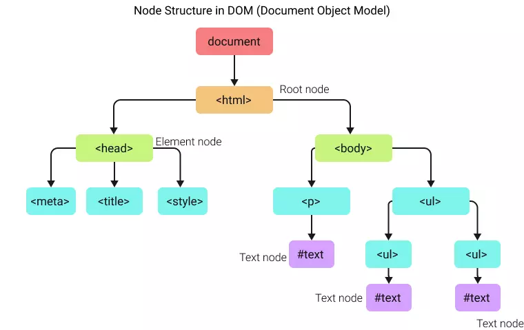

# Node trong JavaScript — Cây DOM được tạo từ gì?

> Bài này giải thích "node" là gì — đơn vị cấu thành cây DOM mà bài trước (README.md) đã giới thiệu. Sau khi đọc, bạn phân biệt được node vs element, và biết cách duyệt cây node bằng JS.

## Node là gì?

- Một **node** là một phần tử của cây DOM — đơn vị dùng để truy cập mọi thành phần của trang web.
- Cây DOM là cây gồm các nút được trình duyệt tạo khi trang được tải. Cây là sự thể hiện của tài liệu HTML. Tất cả phần của cây này — head, body, thẻ HTML, text, attribute... — đều là node.



- Trong hình trên, ở cuối mỗi nhánh luôn tồn tại một node — hoặc là element node, hoặc là text node. Ngoài ra các thứ khác như comment, attribute, CDATA... đều thuộc nhóm node.

> Mỗi node là một **object** có methods và properties riêng — vì vậy người ta cũng gọi node là `node objects`.

**Lưu ý quan trọng**: mỗi HTML element là một node trong JavaScript, nhưng không phải node nào (TextNode, AttributeNode, NamespaceNode...) cũng là một HTML element.

## Các node type — bảng chuẩn theo DOM Living Standard

Đây là bảng mà file gốc có vài chỗ sai giá trị — bạn nên thuộc ít nhất 4 giá trị đầu:

| nodeType | Tên | Ví dụ | Ghi chú |
|---|---|---|---|
| 1 | `ELEMENT_NODE` | `<p>`, `<div>`, `` | Hầu hết công việc hằng ngày của bạn là node này |
| 2 | `ATTRIBUTE_NODE` | `class`, `src`, `title` | Không còn là node con trong DOM hiện đại; truy cập qua `attributes` |
| 3 | `TEXT_NODE` | Text bên trong thẻ | **Bao gồm cả khoảng trắng/indent trong HTML!** |
| 4 | `CDATA_SECTION_NODE` | `<![CDATA[ ... ]]>` | Chỉ trong XML, không xuất hiện trong HTML |
| 8 | `COMMENT_NODE` | `<!-- comment -->` | |
| 9 | `DOCUMENT_NODE` | `document` | Gốc của mọi cây |
| 10 | `DOCUMENT_TYPE_NODE` | `<!DOCTYPE html>` | |
| 11 | `DOCUMENT_FRAGMENT_NODE` | `document.createDocumentFragment()` | Container tạm, không render |

Quy ước đặt tên: element node có `nodeName` là tên thẻ viết hoa (`DIV`, `P`...); text node có `nodeName` là `#text`; document node là `#document`; comment node là `#comment`.

## TextNode

`TextNode` là loại node biểu diễn văn bản nằm giữa các thẻ. Ví dụ, trong mã HTML `<p>Hello, <strong>world</strong>!</p>`, có hai TextNode: một cho "Hello, " và một cho "!".

```js
var paragraphElement = document.querySelector("p");

var childNodes = paragraphElement.childNodes;

for (var i = 0; i < childNodes.length; i++) {
  if (childNodes[i].nodeType === Node.TEXT_NODE) {
    console.log("TextNode:", childNodes[i].nodeValue);
  }
}

// Result: "Hello, " và "!".
```

### Bẫy whitespace — bẫy số 1 khi duyệt node

HTML của bạn gần như luôn có xuống dòng và indent, và **mỗi chỗ đó là một TextNode**:

```html
<ul id="list">
  <li>Một</li>
  <li>Hai</li>
</ul>
```

```js
const ul = document.getElementById("list");

console.log(ul.childNodes.length); // 5! — text node (whitespace) xen kẽ các <li>
console.log(ul.children.length);    // 2 — chỉ đếm element

ul.firstChild.nodeType;              // 3 — là TEXT_NODE (dấu xuống dòng), không phải <li>!
ul.firstElementChild;                // <li>Một</li> — dùng bản "Element" để bỏ qua text
```

Quy tắc thực chiến:

- Muốn **element** → dùng `children`, `firstElementChild`, `nextElementSibling`, `parentElement`
- Muốn **mọi thứ kể cả text/comment** → dùng `childNodes`, `firstChild`, `nextSibling`
- 99% thời gian bạn muốn nhóm đầu tiên.

## AttributeNode và NamespaceNode

- `AttributeNode` (nodeType 2) biểu diễn một thuộc tính của phần tử HTML. Ví dụ với ``, mỗi thuộc tính (src và alt) sẽ được biểu diễn bởi một attribute node.
  - Lưu ý: trong DOM tree hiện đại, attribute **không còn nằm trong `childNodes`** của element (khác với DOM thế hệ cũ) — bạn truy cập qua `element.attributes` hoặc `getAttribute()`.
- `NamespaceNode` thể hiện không gian tên trong XML hoặc XHTML. Trong HTML thông thường, namespace ít khi được dùng; nó quan trọng trong ngữ cảnh XML/XHTML (và chính là lý do bạn phải dùng `createElementNS` khi tạo SVG — xem `21_graphics/01_raster-svg/`).

## Duyệt cây node — các property chuẩn

```
parentNode / parentElement
├── childNodes (NodeList, gồm text/comment)  | children (chỉ Element)
├── firstChild / firstElementChild            | lastChild / lastElementChild
├── nextSibling / nextElementSibling          | previousSibling / previousElementSibling
```

```html
<p id="para">This is a paragraph.</p>
```

```js
// selecting node
let p = document.getElementById("para");
// get node name and node type
console.log(p.nodeName, p.nodeType); // P, 1
// get node name and node type of child node
console.log(p.firstChild.nodeName, p.firstChild.nodeType); // #text, 3
// get node name and node type of next sibling
console.log(p.nextElementSibling?.nodeName); // element phía sau (nếu có)
```

Ví dụ duyệt có điều kiện theo nodeType:

```js
// Chỉ lấy text "thật" (bỏ whitespace thuần túy)
function visibleText(node) {
  let result = "";
  for (const child of childNodesOf(node)) {
    if (child.nodeType === Node.TEXT_NODE) {
      const t = child.nodeValue.trim();
      if (t) result += t + " ";
    } else if (child.nodeType === Node.ELEMENT_NODE) {
      result += visibleText(child);
    }
  }
  return result.trim();
}
```

## Element node — thao tác nhiều nhất

Element node là node bạn thao tác 90% thời gian, với đầy đủ API:

```js
const el = document.querySelector("#para");

el.tagName;                  // "P" — tên thẻ
el.id, el.className;         // thuộc tính cơ bản
el.textContent;              // text bên trong (gồm cả text node con)
el.innerHTML;                // HTML bên trong
el.children;                 // các element con
el.classList.add("active");  // quản lý class
el.setAttribute("lang", "vi");
el.appendChild(node);        // thêm node con
el.remove();                 // tự remove khỏi DOM
```

Bạn sẽ thấy các method này được đào sâu ở các bài `3_element`, `5_text`, `7_node-property` cùng nhóm.

## Document node — gốc của cây

The global node is used to get to all other nodes in the `document` node.

> The `document` node is the root node of the document. It has a nodeType = 9 and a nodeName = `#document`.

Từ `document` bạn đi xuống toàn bộ cây:

```js
document.documentElement; // <html> — element gốc
document.body;             // <body>
document.head;             // <head>
document.doctype;          // <!DOCTYPE html> — nodeType 10

// Ba cách "nhập môn" phổ biến:
document.getElementById("para");
document.querySelector(".item");
document.querySelectorAll("li"); // NodeList (tĩnh) — khác getElementsByTagName trả HTMLCollection (live)
```

Sự khác biệt `NodeList` vs `HTMLCollection` (static vs live) là một trong những bẫy kinh điển của DOM — gặp lại ở bài `2_dom-object`.

## Sơ đồ tổng kết

```
document (nodeType 9)
└── <!DOCTYPE html> (nodeType 10)
└── <html> (nodeType 1, element)
    ├── <head> (element node)
    │   ├── <meta charset="utf-8">  (attribute "charset" là attribute node — nodeType 2)
    │   └── <title> (element)
    │       └── "Trang của tôi" (text node — nodeType 3)
    └── <body> (element)
        ├── <!-- chú thích --> (comment node — nodeType 8)
        └── <p>Hello <strong>world</strong>!</p>
            ├── "Hello " (text node)
            └── <strong> (element)
                └── "world" (text node)
```

Node nào trong sơ đồ trên là "element"? Chỉ những node có nodeType 1. Còn lại là text, comment, attribute... — đó chính là ý của ghi chú "every node is NOT an HTML element" ở đầu bài.

## Checklist tự kiểm tra

- [ ] Thuộc nodeType của: element (1), text (3), comment (8), document (9)
- [ ] Giải thích được tại sao `ul.childNodes.length` không bằng số `<li>`
- [ ] Phân biệt `childNodes` vs `children`, `firstChild` vs `firstElementChild`
- [ ] Biết `document` là node có nodeType 9, nodeName `#document`

## References

- MDN — Node: https://developer.mozilla.org/en-US/docs/Web/API/Node
- MDN — nodeType: https://developer.mozilla.org/en-US/docs/Web/API/Node/nodeType
- What is a node in JavaScript: https://www.tutorialstonight.com/what-is-a-node-in-javascript
